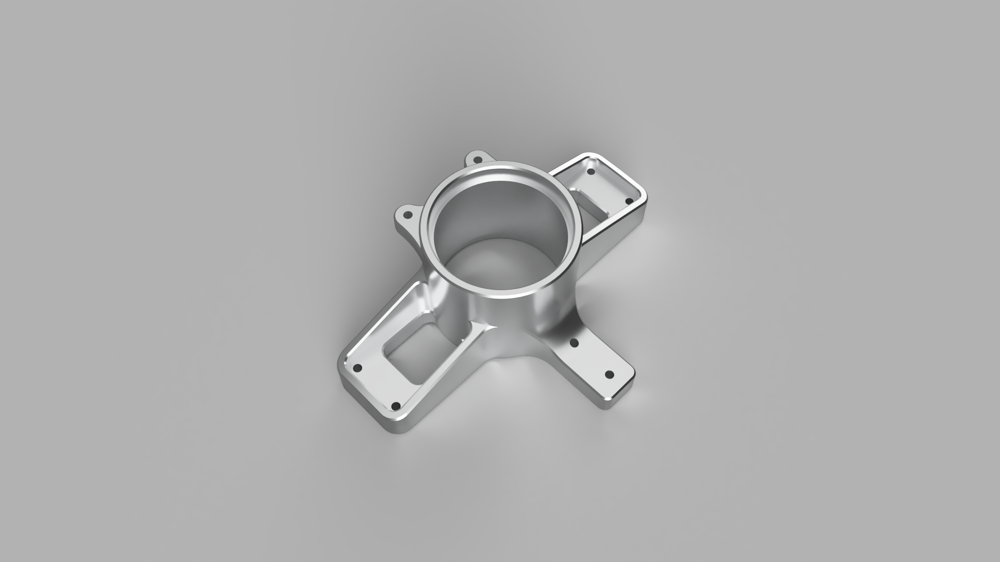

# UFS27 – My work with Uppsala Formula Student

> **TL;DR:** I'm Alexander Olsen, a mechanical engineering student (BSc in Engineering, *högskoleingenjör*)
> at Uppsala University. On Uppsala Formula Student's 2027 electric car (UFS27), I'm in the
> **Uprights & Wheels** division, responsible for the **uprights, rims, tyres and their interfaces to
> suspension and steering**. I also built **SimQ**, the team's tool for managing simulation requests.
> This repository documents what I designed, how I did it, and what I learned.



---

## About Formula Student

[Formula Student](https://www.imeche.org/events/formula-student) is an international engineering competition
where university teams design, build and race a single-seat race car. Teams are judged not only on track
performance but also on engineering design, cost and business presentation. Uppsala Formula Student is
Uppsala University's team.

## My role

|              |                                                             |
| ------------ | ----------------------------------------------------------- |
| **Team**     | Uppsala Formula Student                                     |
| **Car**      | UFS27, electric (2027 season)                               |
| **Division** | Uprights & Wheels                                           |
| **Role**     | Design engineer: uprights, rims, tyres and their interfaces |
| **Period**   | Oct 2026 –                                                  |
| **Tools**    | Autodesk Inventor, Ansys student, Rust, Git/GitHub          |

A teammate and I share everything at the wheel corners beyond the suspension and steering. They own
the wheel hub. I own the rims and tyres, the front and rear uprights, and every connection to the
suspension and steering. I coordinate the design with the suspension and brake groups.

## Highlights

The short version for anyone skimming. Each item links to the full write-up.

- **Concept report v2 after design review.** I addressed all 17 review comments, moved everything to
  FS Rules 2027, chose the tyres (Hoosier R35B 18.0×6.0-10), and recommended 7075-T73 for the upright
  because of its stress corrosion resistance → [details](work/uprights-wheels/README.md#approach)
- **Bearing sizing.** I derived the load cases and the bearing load
  P = (Fy·R − Fz·d)/L, and showed that s₀ ≥ 1.5 needs at least 60.6 / 56.6 mm bearing spacing
  front/rear. I set 65 / 60 mm as a design requirement → [details](work/uprights-wheels/README.md#approach)
- **Front upright V1 designed** for CNC machining in Al 7075, with FEA next
  → [details](work/uprights-wheels/README.md)
- **Built SimQ, the team's simulation request queue.** A cross-platform desktop app in Rust that
  syncs without a server, with 73 automated tests and in-app updates → [details](work/simq/README.md)

## Projects

| Project | Status | Summary |
|---|---|---|
| [Uprights, wheels & tyres](work/uprights-wheels/README.md) | 🟡 In progress | Front/rear uprights, rim and tyre selection, bearing sizing, interfaces |
| [SimQ](work/simq/README.md) | 🟢 In use | Queue and tracker for the team's simulation requests |

Status: 🔵 Planned · 🟡 In progress · 🟢 Done

## Engineering log

A dated diary of decisions, tests and problems: the raw "how I work" behind the projects above.
See the [log index](log/README.md).

## Skills demonstrated

<!-- Keep this honest: only list things that are backed up by a project or log entry. -->

- **Mechanical design:** upright design for CNC in aluminium, component and material selection (tyres, rims, bearings, 7075-T6 vs T73)
- **Analysis:** load case derivation, bearing sizing (static safety factor), finding inconsistencies in my own assumptions, FEA (in progress)
- **Requirements & rules:** design to FS Rules 2027 (T2.5–T2.7, T10), interface coordination between groups
- **Working with feedback & suppliers:** revising a design report after a 17-comment review, comparing suppliers (OZ, Keizer, Braid)
- **Software development:** Rust, desktop GUI, distributed sync without a server, CI/CD with GitHub Actions
- **Teamwork:** coordinating with suspension and brake groups, learning from other teams (KTH visit)

## Repository structure

```
UFS27/
├── README.md          ← you are here (overview for readers)
├── log/               ← dated engineering log entries
├── work/              ← one folder per project / work package
├── media/             ← images, renders, plots, videos
├── templates/         ← templates for new entries and projects
└── new-entry.sh       ← creates a new log entry from the template
```

## Contact

- **GitHub:** [Olsn-Dev](https://github.com/Olsn-Dev)
- **LinkedIn:** www.linkedin.com/in/alexander-olsen1
- **Email:** alexanderolseb@gmail.com

---

<sub>Confidential team data (full CAD, sponsor
agreements, exact setup values) is intentionally left out.</sub>
