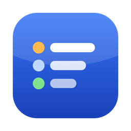
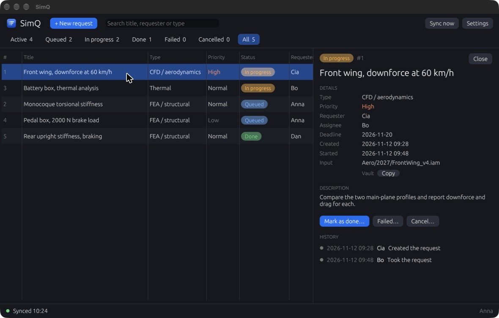

# SimQ – a queue for the team's simulation requests

**Status:** 🟢 v0.4.0 released, in use · **Period:** Nov 2026 – · **Tools:** Rust, egui, SQLite, GitHub API, GitHub Actions
**Code:** [github.com/Olsn-Dev/simq](https://github.com/Olsn-Dev/simq)

## Problem

Across the team, people constantly need simulations done (FEA on a part, CFD on an aero
concept and so on), and the people who can run them are few. Requests were spread across chat
threads and conversations. It was hard to see what was waiting, who had taken what, and where the
finished report and results ended up.

## Requirements

| Requirement | Why |
|---|---|
| No server to host or pay for | A student team has no IT department and members change every year |
| Works for people who aren't programmers | Most team members are mechanical engineers |
| Works offline, syncs later | Workshop and travel connectivity is unreliable |
| Two people taking the same request must not cause a conflict | The queue has to be trustworthy |
| Windows, macOS and Linux, nothing to install | The team uses all three |
| Swedish and English | Mixed team |

## Approach

**Shared event log, no server.** Instead of a database on a server, every change (request
created, taken, completed, and so on) is written as a small immutable event file. Each app replays
all events to rebuild the same queue. Files are never edited or deleted, so syncing reduces to
"copy files you don't have yet". This works over two kinds of storage:

- a **private GitHub repository** through the GitHub API, where team members only need a team key
  and don't need their own GitHub account, or
- an **ordinary shared folder**, for example Google Drive.

**Deterministic conflict resolution.** Events are ordered with a *hybrid logical clock*, which
stays monotonic even if a computer's system clock is wrong. When two people take the same request
at the same time, every app independently picks the same winner.

**Treat shared data as untrusted.** Everything read from the shared storage is size-limited,
strictly parsed and validated before use.

**Distribution.** GitHub Actions builds a single self-contained file for each OS on every release.
The app checks for updates on startup and can update itself.

## Result

- Desktop app in **Rust** with an **egui** interface, about 11 000 lines of code.
- Queue, assignment, completion with report/result links, and file upload (up to 500 MB).
- Sync via GitHub or a shared folder, offline support, local SQLite cache.
- Swedish/English chosen per user.
- Automated cross-platform release builds and in-app updates.
- Iterated from first version to v0.4.0 in the first development sprint (new design, deleting
  requests, in-app updates, file uploads).

## Testing & validation

- 73 automated tests, covering among other things clock ordering, event replay and concurrent claims.
- <!-- TODO: how the team uses it, number of users/requests, feedback -->

## What I learned

<!-- TODO: write in your own words. Some prompts: -->
<!-- - Why an append-only event log made sync simpler than a shared database -->
<!-- - Designing for non-technical users (team key instead of GitHub accounts, unsigned app warnings) -->
<!-- - What you would do differently -->

## Related log entries

- [2026-11-12 – SimQ first version](../../log/2026-11-12-simq-first-version.md)
