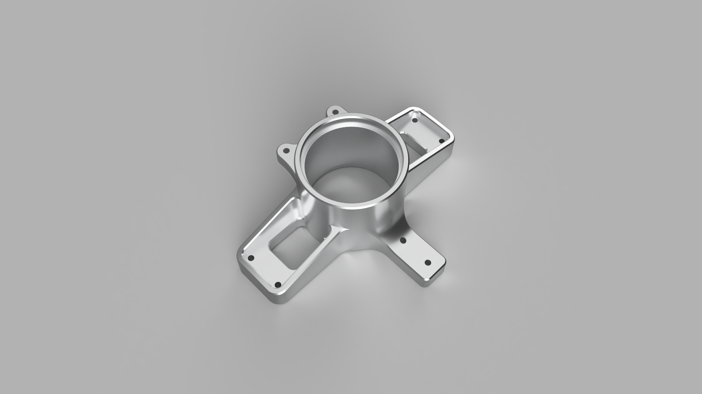

# Uprights, wheels & tyres

**Status:** 🟡 In progress (concept report v2 done, waiting on rim quotes, upright FEA next) · **Period:** Oct 2026 – · **Tools:** [TODO: CAD/FEA software]

## Problem

The car is an electric Formula Student car with driveshafts at both the front and the rear. Everything
at the wheel corners beyond the suspension and steering must carry all of the car's loads into the
chassis, and it must stay light, stiff and rule-compliant. A teammate and I share the wheel-corner
package: they own the wheel hub, and I own the rest:

- rims and tyres
- front upright (with steering) and rear upright (without steering)
- all interfaces to suspension, steering and brakes

I coordinate the design with the suspension and brake groups.

## Requirements

**Rules (FS Rules 2027 v1.0):** wheels T2.6, tyres T2.7, suspension travel T2.5.1, fasteners T10.
Also 5 mm clearance between the rim and non-rotating parts (T2.4.4 in the 2026 rules).

**Base parameters (fixed ~2026-10-12):**

| Parameter | Value |
|---|---|
| Tyre size | 18" |
| Rim offset (car geometry) | 50.8 mm |
| Drive | Driveshafts front and rear, so hollow hubs (probably aluminium) |

**Design loads per front wheel** (N, before safety factor):

| Load case | Fz | Fy | Fx |
|---|---|---|---|
| Static | 662 | – | – |
| Cornering, outer wheel | 1 000 | 1 801 | – |
| Braking | 1 175 | – | 1 589 |
| Bump, 3 g | 1 987 | – | – |

These are based on preliminary assumptions (300 kg car, 45/55 weight distribution, CoG height 0.30 m,
1.8 g lateral, tyre friction 1.8, 1.8 g braking with 60 % on the front, 50 mm from the tyre centre
plane to the bearing pair centre plane). I'm replacing them with the team's real vehicle data as it
becomes available.

> ⚠️ In report v2 I found that the cornering and braking cases imply different CoG heights
> (~153 mm vs ~300 mm). The affected case will be recalculated.

## Approach

**Component choices**

| Component | Choice | Status / notes |
|---|---|---|
| Tyre | Hoosier 18.0×6.0-10, compound R35B | ✅ Decided. ~4.08 kg each. Harder than R20/R25B/LC0, but needs ~5–10 °C more heat |
| Rim | Leaning towards Keizer | ⏳ Waiting for quotes. Reference: OZ Magnesium CL 10" (1.66 kg, offset 22 mm). Alternatives: OZ Hybrid Carbon (1.35 kg), Braid Sturace |
| Bearings | Thin-section deep groove ball bearings (SKF 61811-2RZ front / 61815-2RZ rear) | ⏳ Quotes requested from NSK and FAG. Fallback: 32009X tapered roller bearing |
| Upright material | Al 7075, CNC-machined | Recommending **T73** over T6 for better stress corrosion resistance |
| Hub | Made in-house | Drawings wait for the rim choice. Backups: go-kart hub, or outsourced CNC |
| Wheel nut | Castle nut + split pin vs KM lock nut + MB washer | Under evaluation |

A wheel assembly (rim + tyre) weighs about **5.74 kg per corner, ≈ 23 kg per car**.

**Bearing check.** The bearing pair carries the tyre forces as a moment, so the bearing load is

P = (Fy·R − Fz·d) / L

where R is the rolling radius, d the distance from the tyre centre plane to the bearing pair centre,
and L the bearing spacing.
To reach a static safety factor **s₀ ≥ 1.5** in the cornering case, L must be at least
**60.6 mm front and 56.6 mm rear**. I rounded these up to **65 / 60 mm**, which is now a design
requirement for both the upright and the hub. If the ball bearings don't fit, the fallback is a
32009X tapered roller bearing.
Limitations: the model uses radial load only, so the margin is slightly optimistic, and L10 life is
not calculated yet.

**Concept report (2026-11-03).** A component list (front/rear upright, hub, wheel bearings, wheel
nut, hub nut, wheel studs) and a concept report covering rule requirements, the bearing check, risks
and next steps.

**Learning from others.** On 2026-11-10 I visited KTH Formula Student to see how they design and
build their wheel assemblies. [TODO: 1–2 concrete takeaways]

**Front upright V1 (2026-11-11).** First draft, designed to be CNC-machined in aluminium 7075.

**Concept report v2 (2026-11-24).** I addressed 17 review comments, with an appendix that tracks the
change made for each one. I also moved all rule references to FS Rules 2027, re-derived the load cases
step by step, added alternatives and risks for every component, and rewrote the report in plainer language.

## Result

<!-- TODO: fill in when V1 is analysed: mass, max stress, safety factor, deflection -->

| | Front upright V1 |
|---|---|
| Material | Al 7075 (T73 recommended) |
| Bearing spacing | 65 mm (requirement) |
| Mass | [TODO] |
| Min. safety factor | [TODO] |
| Max. deflection | [TODO] |

## Testing & validation

Detailed simulation, test and version reports are in [`results/`](results/).

| Date | Result | Type | Outcome |
|---|---|---|---|
| | *Front upright V1 – FEA* (planned) | FEA | |

- **Next step:** FEA of Front upright V1 under the load cases above.

## Open questions

- **Rim offset:** OZ states 22 mm, our geometry uses 50.8 mm. To be resolved with the supplier and
  the suspension group.
- **CoG height** differs between the cornering and braking load cases (~153 vs ~300 mm). Needs
  checking and recalculation.
- **Rolling radius** in the bearing model (0.2255 m) was matched to the original report's 8.9 kN.
  The original model still needs to be confirmed.
- **Driveshaft / CV joint outer diameter** is unknown. It sets the hub's inner diameter and whether
  a 32009X fits.
- **Not yet verified:** number of drive pins on the OZ rim, Keizer/Braid weight and price, R35B wear.
- **Mounting points** with suspension, steering and brakes, plus the 5 mm rim clearance.

## What I learned

<!-- TODO: write in your own words when V1 is done -->

## Related log entries

- [2026-10-08 – Assigned uprights, wheels and tyres](../../log/2026-10-08-assigned-uprights-wheels-and-tyres.md)
- [2026-10-12 – Base parameters fixed](../../log/2026-10-12-base-parameters-fixed.md)
- [2026-11-03 – Component list and concept report](../../log/2026-11-03-component-list-and-concept-report.md)
- [2026-11-10 – Visit to KTH Formula Student](../../log/2026-11-10-visit-to-kth-formula-student.md)
- [2026-11-11 – Front upright V1 first draft](../../log/2026-11-11-front-upright-v1-first-draft.md)
- [2026-11-24 – Concept report v2](../../log/2026-11-24-concept-report-v2.md)
